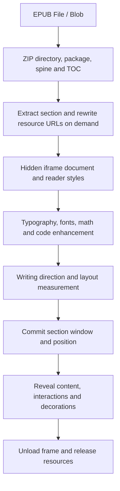

# Rendering design

This is the authoritative rendering design. Development and validation commands
belong in [AGENTS.md](AGENTS.md); terminology belongs in [GLOSSARY.md](GLOSSARY.md).

## Ownership and pipeline

Reader composes EPUB parsing, Renderer, and Typography, and owns navigation,
settings, persistence, input, and UI. Renderer owns mounting, layout, geometry,
pagination, scrolling, and positioning. Typography owns publication styles, fonts,
semantic enhancement, footnotes, code highlighting, and math. Dependencies point
from Reader to the lower layers; Renderer and Typography do not import each other
or Reader. Reader supplies the document preparation callback.

`app/epub/book.ts` retains the ZIP source until book destruction. URL opening first
fetches a Blob. ZIP readers disable zip.js workers per instance. The parser loads
sections lazily and rewrites XHTML, CSS, and SVG dependencies into cached Blob URLs.
Active sections pin their resource trees; unloading releases those pins.

`SectionFrame` loads a hidden iframe with `sandbox="allow-same-origin"` (without
scripts), runs document preparation, waits for fonts, measures writing direction
and layout, then observes expansion. Synchronous and asynchronous initialization
failures must both settle its loading promise. Destroy aborts loading, cancels
scheduled expansion, and releases document references.

Typography sets language and preserves publisher fixed layout by skipping
reflowable enhancement for fixed documents. Reflowable preparation starts font
loading, conditionally loads MathJax and highlight.js, applies font mapping,
semantics, tables, footnotes, images, and reader styles, and waits for fonts.
Math and code enhancement can proceed concurrently; cancellation is checked across
async boundaries. Failed highlighting leaves original content intact. Fonts and
late resource expansion can trigger further layout; initial measurement does not
prove all images have reached their final dimensions.

## Modes and section windows

| Mode | Layout and navigation |
| --- | --- |
| Paginated | Continuous column track across sections; `prev`/`next` move one column, `prevPage`/`nextPage` move the visible column count. |
| Scrolled | Continuous section track; screen movement is a viewport-sized scroll, not a discrete page number. |
| Fixed | Publication-defined page geometry, managed by the fixed renderer. |

`ReaderView` chooses the renderer. Paginated and scrolled modes share
`ReflowableSpine` for loading, styles, and virtual section windows. Each renderer
owns its track, visible-position sampling, boundary decisions, and movement plans.
An iframe is the indivisible section layout unit; windowing does not split a large
chapter into smaller documents.

The reflowable window pipeline is:

1. Resolve a semantic target and prepare hidden frames through `SpineBuffer`.
2. Finish document enhancement and measurement before committing membership.
3. Lay out the committed frames on the mode's track. When sections before the
   active section change, compensate the viewport by its old/new offset difference.
4. Project the target to physical coordinates and record the actual browser landing.
   `ScrollCoordinator` suppresses duplicate programmatic scroll sampling; user
   scroll sampling is coalesced per animation frame.
5. Commit a section-bound position and let Reader derive CFI and book progress.

`SpineBuffer` owns staged/committed membership and stale loads; Track owns geometry;
`NavigationTransaction` owns movement/reflow exclusion; `SectionFrame` owns its
document lifetime. Cache preparation can run asynchronously in both directions.
Reconciliation uses layout/viewport snapshots, generation and membership revisions,
and a navigation-safe commit. Waiting work rechecks ownership after waking.
Cache scheduling uses animation frames and must never restart after destruction.

## Positions and cancellation

`ReadingPosition` (`index`, `fraction`, optional `range`) is the sole logical
position crossing layout boundaries. Fraction is always available as fallback.
A Range must belong to that section's currently mounted document. Pixel offsets,
column numbers, and window coordinates stay internal and must not be persisted.
Neither a Range nor a fraction may be borrowed from another section.

Reader persists an exact CFI when possible and always retains whole-book progress
as fallback. A missing Range must not produce a synthetic section-start CFI.
Reflow and mode changes retain the logical reading edge; user movement samples a
new edge. Restoration aligns to the first visible column or top reading inset,
clamped to book boundaries. Active navigation keeps an already visible target in
place. Geometry uses a cloned Range; CFI persistence uses its collapsed start.

For paginated and scrolled modes, only `#scrollTo()` commits ReadingPosition and
emits `relocate`. Animation frames and intermediate cache jumps change physical
offsets only. Cancellation, destruction, or mode replacement invalidates the old
navigation revision before it can commit. Direct user scrolling supersedes queued
and animated scroll navigation. Layout changes coalesce into reflow after navigation;
cache membership commits wait for navigation to be idle. The shared transaction
understands exclusion, not mode-specific geometry.

Mode switching is serialized. Prepare a hidden replacement renderer and navigate
it to the semantic target before swapping the active renderer. Failure destroys
the replacement and retains the old renderer; success detaches and destroys the
old one. Without an exact CFI, retain the section fraction.

Scrolled boundaries use `contentExtent` with a 2 CSS pixel tolerance.
`physicalExtent` includes trailing alignment space and must not affect progress
or end-of-book detection. Visible Range sampling uses the iframe/viewport
intersection converted into iframe coordinates: top for horizontal writing, left
for vertical-lr, right for vertical-rl. Hidden frames cannot supply visible Ranges.
Cache changes can preserve a CFI while changing track pixels; compare semantic
anchors when checking position preservation.

## Input and decorations

OverlayInput excludes reader gestures while an overlay owns input and consumes
the dismissing gesture. Content ownership resolves controls, links, annotations,
zoomable images, then ordinary content. Generic focusability is a fallback and
must not hide link semantics. Retain the strongest claim through gesture end.

Selection takes priority over page gestures. Secondary press with a selection
opens its context menu without starting a drag; primary selection movement suppresses
the following click. Double-click cancels a pending single-click turn. Selection-edge
following requires active primary selection in the current document. Release,
cancel, context menu, and blur terminate delayed work.

Input translates spatial directions into reading-order commands before navigation.
Right-button page dragging advances left/up and returns right/down, with horizontal
reversal for RTL. Release needs 40 CSS pixels and a dominant axis at least 1.2 times
the other; grab feedback begins after 150 ms or 8 pixels. Escape, blur, lost capture,
extra buttons, overlays, and section unload cancel it. Quick right clicks retain
context menus. Controls and other semantic owners retain priority.

Annotations retain logical CFI identities across remounts, not live DOM Ranges.
Relocation is the persistence boundary. Saves capture both book generation and edit
revision: a completed save must not clear later edits or another book's state.

## Search

Compile Segmenter, Collator, and the normalized needle once per query. Stream DOM
text through a query-sized window preserving cross-node matches, Unicode graphemes,
normalized whitespace, and overlapping matches. `find` returns synchronous ranges;
`scan` supplies batch checkpoints so book search can yield and honor cancellation,
even for a long chapter without matches. Parsing and individual platform segmentation
calls remain synchronous: cancellation is cooperative, not worker interruption.

Source documents provide persistent CFIs; enhanced rendered documents are searched
separately because typography can change structure. A query-scoped WeakMap caches
at most 200 matching ranges per rendered document. Returned anchors clone ranges;
a remounted document is a new key. Clearing a query removes decorations and its
cache. Rendered text is assumed stable after enhancement, not live editable text.

## Memory, cleanup, and performance boundaries

| Owner | Retention and limits |
| --- | --- |
| ZIP source | Original File/Blob remains for the open book; decompression creates additional data. |
| ResourceCache | Default 64 MiB budget, trimming toward 48 MiB using Blob sizes and LRU. Only unpinned resources without parent references can be evicted; active dependency trees may exceed the budget. Eviction revokes URLs and releases child references. |
| SpineBuffer | Preload two viewports in either direction, retain three; at most 16 loads per direction per reconciliation. These are window heuristics, not a hard iframe or memory cap. |
| Mounted/staged frames | DOM, styles, fonts, layout, decoded images, decorations, and browser compositor allocations are outside the Blob budget. Large chapters remain large layout units. |
| Search | Up to 200 cached rendered matches per document per query, plus source scanning and results. |
| Math SVG cache | Book-scoped LRU, at most 1,500 entries or 12 MiB estimated UTF-16 key/markup storage; glyph DOM and browser allocations are additional. |
| Saving | ZIP output and temporary buffers can coexist with reading resources. |

Frame removal emits unload, destroys its view, removes DOM, and releases section
resources. Clearing the spine disposes staged and committed frames and invalidates
pending loads. Reader disposal aborts navigation, destroys the view and book, and
releases the platform source in cleanup. App teardown also removes interactions,
listeners and decorations and clears the math cache around book changes.

The pipeline uses browser DOM layout, not a PDF raster/WASM-to-canvas pipeline.
Do not infer zero-copy behavior or total memory bounds from Blob accounting or
window size. Likely costs include ZIP extraction and URL rewriting, document parsing,
typography/math/highlighting, font waits, style/layout, large decoded images, search,
and save compression. Measure these separately on representative books before
changing scheduling or retention. Generated fixtures verify selected invariants,
not every publication, writing mode, delayed image, or native file-picker path.

The original renderer and parser derive from
[foliate-js](https://github.com/johnfactotum/foliate-js); retain
[the renderer license](app/renderer/LICENSE.txt).
